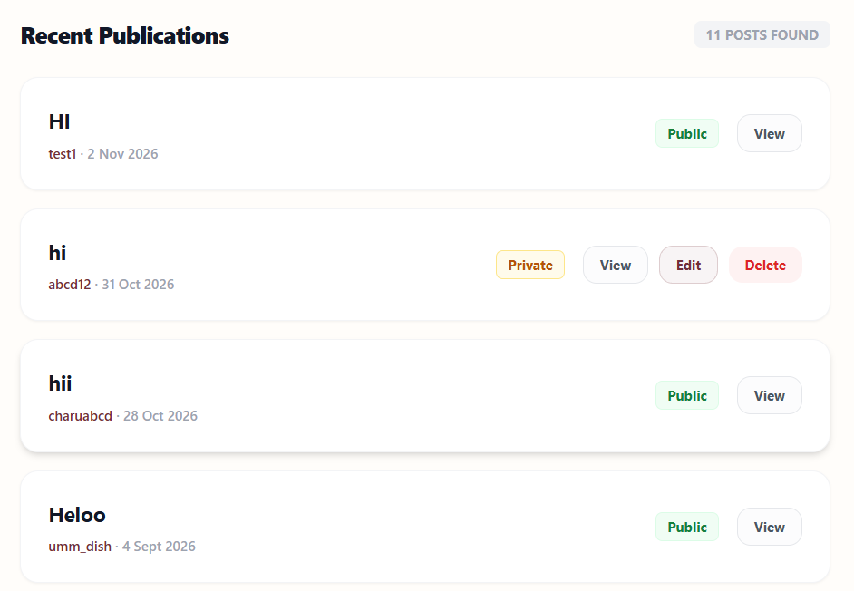
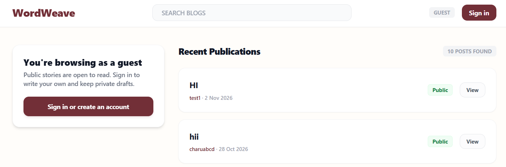
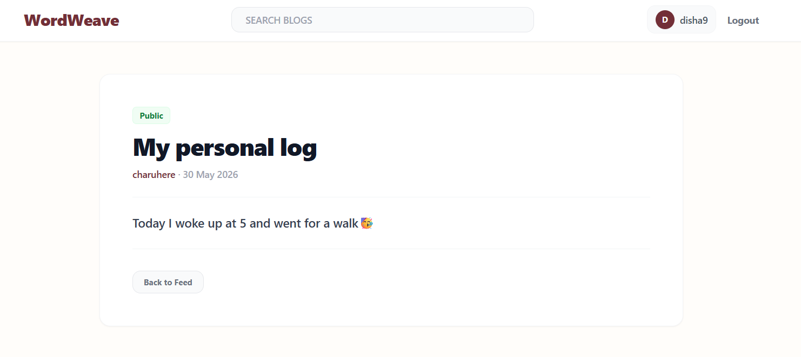
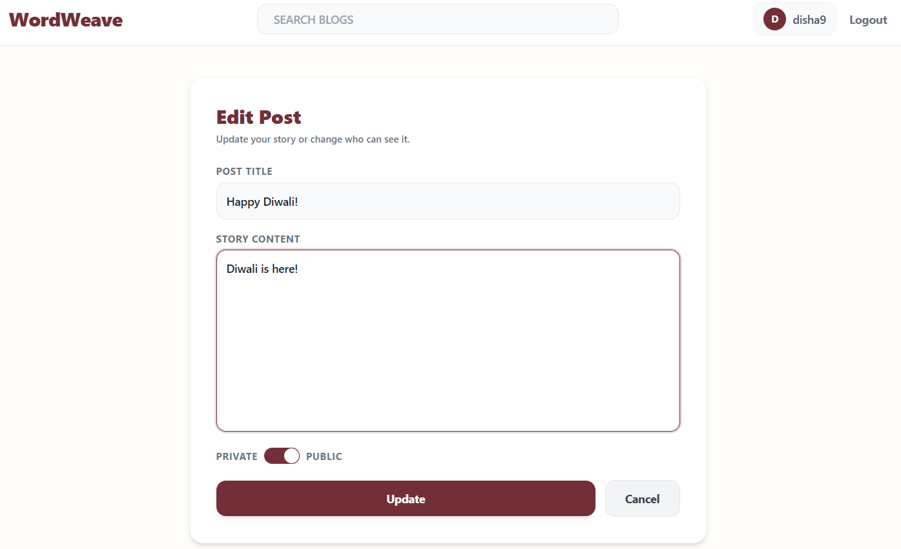

# WordWeave: A Full-Stack MERN Blogging Platform

Hey there! I'm Disha, and WordWeave is my first solo full-stack project. It is a blogging platform where people can write posts, keep them public or private, and search through stories. It started as a server-rendered Express + EJS app, and I later migrated it to a **MERN stack** with a React frontend and a REST JSON API.

[](https://wordweave-2yk8.onrender.com/)

> The first request after a while can take 30-50 seconds, because the free Render instance sleeps when idle.
>
> The original server-rendered version lives on the [`ejs-version`](https://github.com/dish982/WordWeave/tree/ejs-version) branch.

## Screenshots

| Feed | Guest view |
|---|---|
|  |  |

| Post page | Edit / delete |
|---|---|
|  |  |

## Features

- **Authentication:** signup and login with salted password hashing and server-side sessions stored in MongoDB.
- **Guest mode:** visitors can browse and read public posts without an account. Writing requires signing in.
- **Full CRUD:** create, read, edit and delete posts. Only the author can edit or delete, and this is enforced on the server.
- **Privacy toggle:** posts are Public or Private. Private posts are visible only to their author, and anyone else gets a 404, even with the URL.
- **Search:** server-side keyword search across titles and content, with user input escaped so special characters are safe.
- **Responsive UI:** Tailwind CSS with a maroon and cream theme.

## Tech Stack

| Layer | Technology |
|---|---|
| Frontend | React (Vite), React Router, Context API, Tailwind CSS |
| Backend | Node.js, Express 5, REST JSON API |
| Database | MongoDB Atlas, Mongoose |
| Auth | express-session, connect-mongo, Node `crypto` (PBKDF2 + per-user salt) |
| Deployment | Render (Express serves the built React app) |

## Architecture

```
Browser (React)  --fetch + session cookie-->  Express /api routes  -->  Mongoose  -->  MongoDB Atlas
```

- **Development:** two servers. Vite runs on port 5173 and proxies `/api` to Express on port 3000, so the browser sees a single origin.
- **Production:** one server. Express serves the API and the built React app (`client/dist`) from the same origin, so session cookies work without CORS.

## API

| Method and path | Auth | Purpose |
|---|---|---|
| POST `/api/auth/signup`, `/login`, `/logout` | none | account and session |
| GET `/api/auth/me` | none | current user, or `null` for guests |
| GET `/api/posts?search=` | optional | feed: public posts, plus your own if logged in |
| GET `/api/posts/:id` | optional | single post (404 if private and not yours) |
| POST `/api/posts` | required | create a post |
| PUT / DELETE `/api/posts/:id` | required, owner only | update or delete |

## Security Notes

While migrating, I audited the original app and fixed these issues:

- Password hash and salt could be exposed by `populate()`. The API now selects only `username` and builds each response by hand.
- Private posts were readable by anyone who knew the URL. The server now returns 404 unless you are the author.
- Posts were looked up by title, which is not unique. They are now looked up by `_id`.
- Post content was rendered unescaped, which allowed stored XSS. React escapes output by default.
- Search input went straight into `$regex`, which could crash or abuse the query. It is now escaped.
- Login errors revealed whether an email was registered. They now return one generic message.
- Logout was a GET request. It is now a POST.
- Session cookies are `httpOnly`, `sameSite: lax`, and `secure` in production.

## What I'd Improve

- Move from PBKDF2 (1000 iterations) to bcrypt or a higher cost, with lazy re-hashing on login.
- Add rate limiting on login and security headers (`helmet`).
- Add API tests and a CI pipeline (GitHub Actions).
- Add Markdown support, pagination and tags for posts.
- Containerize with Docker.

## Run Locally

1. Clone and install:
   ```bash
   git clone https://github.com/dish982/WordWeave.git
   cd WordWeave
   npm install
   npm install --prefix client
   ```
2. Create a `.env` file in the project root (never commit it):
   ```
   PORT=3000
   MONGODB_URI=your_mongodb_connection_string
   SESSION_KEY=a_long_random_string
   ```
3. Start the API and the frontend in two terminals:
   ```bash
   npm run dev
   npm run dev --prefix client
   ```
4. Open `http://localhost:5173`.

## Production Build

```bash
npm run build   # builds the React app into client/dist
npm start       # Express serves the API and the built app
```

On Render: build command `npm install && npm run build`, start command `npm start`, with `NODE_ENV=production`, `MONGODB_URI` and `SESSION_KEY` set.

## Author

Made with ❤️ by [Disha](https://github.com/dish982)

*This project is for educational and portfolio purposes.*